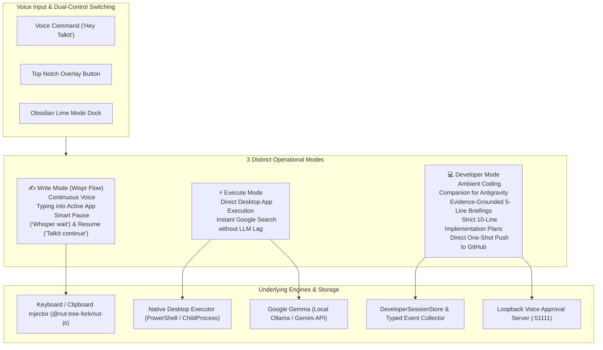
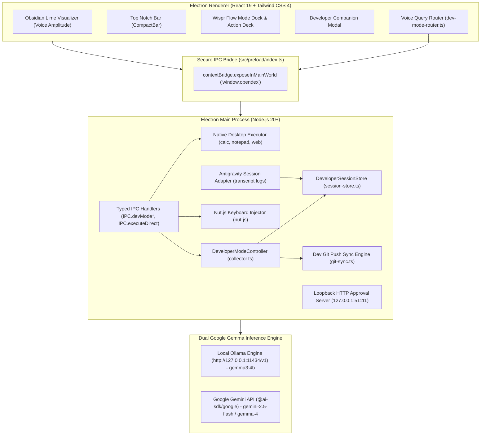

<div align="center">

# 🎙️ TalkIt

### A Windows-First, Voice-Native Desktop Copilot & Ambient Developer Companion

[](https://wemakedevs.org)
[](https://wisprflow.ai)
[](https://ai.google.dev/gemma)
[](https://github.com/GovindUpadhyay13/TalkIt)
[](LICENSE)

*Speak to write. Talk to act. Observe your coding sessions hands-free.*

---

</div>

## 🏆 Built for "No Hands: The Wispr Challenge"

> *"If you can speak it, you can build it."* — **WeMakeDevs & Wispr Flow**

Software developers spend their days constantly context-switching between code editors (VS Code, Antigravity, Cursor), terminal prompts, browser tabs, and autonomous AI agents. While modern background agents can write code rapidly, the developer interaction model remains fragmented:

1. **Repetitive Typing Fatigue**: Writing code comments, documentation, commit messages, and prompt refinements manually when voice dictation is 3× faster.
2. **Window-Switching Friction**: Alt-Tabbing away from your active editor just to trigger simple commands, open utilities, or perform quick Google searches.
3. **Agent Blindness & Unverified Claims**: Autonomous coding agents often claim an action was completed when it wasn't, or leave developers lost about what was actually verified versus what failed.
4. **Manual Git Overhead**: Staging modified files, writing commit messages, and pushing to remotes over and over again.

**TalkIt** was conceived and built for **The Wispr Challenge** to eliminate this friction entirely. It brings a unified, voice-native layer to your desktop, pairing **Wispr Flow continuous voice dictation** with **direct desktop automation** and an **ambient, evidence-grounded Developer Companion** for coding environments.

---

## ⚡ The Three Core Operational Modes

TalkIt enforces strict, explicit mode boundaries so voice typing never accidentally executes commands, and background observation never interferes with your workflow:



---

### 1. ✍️ Write Mode: Wispr Flow Continuous Voice Typing

TalkIt turns your voice into natural, continuous keyboard input directly into any active application (VS Code, Antigravity, Cursor, Slack, Terminal, Obsidian, Chrome):

- **Continuous Stream Dictation**: Dictate fluidly without stopping. TalkIt automatically injects text into the active cursor position.
- **Voice Flow Control**:
  - Say `"Whisper wait"` &rarr; TalkIt pauses dictation, commits pending text, and lets you inspect or type on the physical keyboard.
  - Say `"TalkIt continue"` &rarr; TalkIt resumes voice typing seamlessly.
- **1-Second Smart Silence Endpointing**: Intelligently detects natural pauses in speech and finalizes the transcription buffer after 1 second of silence.
- **Safe Clipboard Preservation**: Transcriptions are injected via `@nut-tree-fork/nut-js` and OS clipboard APIs. Your previous clipboard content is preserved and restored within 120ms without data loss.
- **Deduplication Guard**: Buffer suppresses duplicate pastes and maintains a clean, bounded history of recent dictations.

---

### 2. ⚡ Execute Mode: Direct Desktop Actions & Web Search

TalkIt strictly isolates command execution from voice typing. When in Execute Mode (toggled via voice or on-screen button), TalkIt runs real desktop commands without cloud latency:

- **Dual-Control Mode Toggle**:
  - **By Voice**: Say `"Hey TalkIt, execution mode [command]"` or `"execution mode"` to enter Execute Mode; say `"switch to typing mode"` to return to dictation.
  - **By Screen**: Click the `[⚡ EXEC ON / EXEC OFF]` toggle pill on the floating top notch bar or the main studio deck.
- **Sub-50ms Direct Native Execution**: Launches local Windows applications instantly without waiting for cloud LLM roundtrips:
  - **Calculator**: *"open calculator"*, *"launch calc"*
  - **Notepad**: *"open notepad"*, *"launch text editor"*
  - **Terminal**: *"open terminal"*, *"launch powershell"*, *"launch cmd"*
  - **System Settings**: *"open settings"*, *"system settings"*
- **Instant Google Search**: Say *"search on google for Next.js 15 app router"* or *"search for typescript 5.5 release"*; TalkIt directly opens your default browser to the search results without AI latency.
- **Deterministic Gemma Skills**: Complex requests leverage Google Gemma with sandboxed skills:
  - `openUrl`: Strictly validates protocols, allowing only `http:`, `https:`, and `mailto:` (rejects dangerous schemes like `file:`, `javascript:`, `smb:`).
  - `notesSkill`: Creates, lists, and reads structured local markdown research notes.
  - `weatherSkill`: Live meteorological forecast queries via Open-Meteo.
  - `webSearchSkill`: Deep real-time web intelligence powered by Tavily.

---

### 3. 💻 Developer Mode: Ambient Coding Companion for Antigravity

TalkIt acts as a background development observer for **Antigravity** and local coding environments. It never interferes with your editor, never hijacks your terminal, and runs silently in the background:

- **Verified vs. Reported Evidence Separation**:
  - TalkIt distinguishes between what an AI agent *claims* it did versus what was *independently verified* through command exit codes (`0`), passing tests, or filesystem edits.
- **User-Triggered "Catch Me Up" (Strictly 5 Lines)**:
  Saying `"catch me up"` or `"what has been implemented"` produces a concise, strictly 5-line evidence summary:
  ```text
  1. Goal: Build an authentication module and test suite
  2. Verified: Completed npm test (exit code 0); git status verified clean
  3. Reported: Agent claimed auth token generator was optimized (unverified)
  4. Active & Blockers: In progress: API endpoint refactor. Blockers: No blockers.
  5. Next Steps: Pending permissions: None. Next: Implement refresh token rotation.
  ```
- **"Implementation Plan" (Strictly 10 Lines)**:
  Saying `"give me the implementation plan"` retrieves the captured plan or generates a newly labeled proposal with strictly 10 numbered, evidence-linked steps.
- **One-Shot Direct Push to GitHub**:
  In Developer Mode, say **`"push to github"`**, **`"commit and push"`**, or **`"push changes to github"`** (or click `[Push to GitHub]` in the UI). TalkIt automatically:
  1. Stages all changes (`git add -A`).
  2. Checks `git status --porcelain`.
  3. Generates an intelligent, timestamped commit message.
  4. Pushes cleanly to the active remote branch (`git push origin <branch>`).
  5. Returns the short commit SHA and file count confirmation.

---

### 4. 🛡️ TalkIt Approve: Hands-Free Voice Approvals for Agents

When external coding tools (Claude Code, Cursor, Copilot CLI, terminal scripts) attempt sensitive operations (running bash commands, editing configurations, deleting files):

1. The external agent invokes the CLI hook: `node scripts/talkit-approval-hook.js`.
2. The hook contacts TalkIt's loopback HTTP server (`http://127.0.0.1:51111/v1/permissions/request`).
3. TalkIt displays the permission prompt and speaks it aloud: *"Your Claude Code wants to run command: npm install express. Allow this request?"*
4. Speak your decision naturally:
   - *"Allow once"* / *"Go ahead"* &rarr; grants single-turn permission (exit code `0`).
   - *"Always allow"* &rarr; remembers permission for this action type.
   - *"Deny"* / *"No"* &rarr; rejects permission (exit code `1`).
   - *"Explain that again"* &rarr; repeats details aloud without resolving.
   - *Ambiguous speech* &rarr; conservative parser never guesses; requests clarification.
   - *60s Timeout* &rarr; fails closed to **Denial** (`deny`).

---

## 🎨 Dual User Interface Architecture

TalkIt provides two distinct, synchronized interface surfaces styled in signature **Obsidian Lime** (`#181f18`, `#343D34`, and `#C5F467` vibrant lime accents):

### 1. Unified Floating Top Notch Bar (`CompactBar`)
A discreet, transparent dynamic island pinned to the top of your screen:
- **Audio Wave Visualizer**: Amplitude-reactive sound bars that animate with your voice.
- **One-Click Mode Toggles**:
  - `[⚡ EXEC ON / EXEC OFF]`: Instantly switch between Wispr Flow voice typing and desktop command execution.
  - `[</> DEV ON / DEV OFF]`: Toggle Antigravity session monitoring.
- **Status Pills**: Live captions for `Transcribing`, `Whisper Paused`, `Executing`, or `Listening`.

### 2. Obsidian Lime Desktop Studio & Wispr Flow Control Deck
The main window features a dedicated Wispr Flow–inspired docked control deck:
- **Mode Switcher Dock**:
  - `[✍️ Write Mode]`: Dictate directly into active applications.
  - `[⚡ Execute Mode]`: Desktop commands & Google search.
  - `[💻 Dev Companion]`: Opens the Developer Companion session viewer.
- **Wispr Flow Action Deck**:
  - `[📋 Copy Last]`: One-click copy of the latest transcription to clipboard (with animated `✓ Copied!` checkmark).
  - `[⏸️ Whisper Wait / ▶️ TalkIt Continue]`: One-click pause and resume for continuous dictation.
  - `[🚀 Push to GitHub]`: One-click git staging, commit, and push.
  - `[⚡ 5-Line Catch Up]`: One-click trigger for verified session briefings.
  - `[📋 10-Line Plan]`: One-click trigger for 10-step implementation roadmap.
  - `[🔍 Search Web]`: Direct Google search trigger.

---

## 🧠 Architecture & Engineering



---

## 🚀 Quick Start (Windows-First)

### Prerequisites

- **Operating System**: Windows 10 or 11 (x64 / arm64). *(macOS 13+ and Ubuntu 22.04+ also supported)*.
- **Node.js**: `v20.x` or higher (`node -v`).
- **pnpm**: `v10.x` or higher (`npm install -g pnpm`).
- **Git**: Installed and available in PATH.

### 1. Clone & Install Dependencies

```bash
git clone https://github.com/GovindUpadhyay13/TalkIt.git
cd TalkIt
pnpm install
```

### 2. Configure Your Preferred Inference Engine

#### Option A: Local & 100% Private via Ollama (No API Key Required)
1. Install Ollama from [ollama.com](https://ollama.com).
2. Pull the recommended Gemma model:
   ```bash
   ollama run gemma3:4b
   ```

#### Option B: Cloud High-Speed via Google Gemini API
1. Obtain a free API key from [Google AI Studio](https://aistudio.google.com/apikey).
2. Create a `.env` file in the root directory:
   ```env
   GEMINI_API_KEY=AIzaSyYourGoogleApiKeyHere
   ```
   *(Or simply enter the key in the TalkIt Settings UI <kbd>⚙️</kbd>).*

### 3. Run Automated Tests

Verify that all **44 unit and integration tests** pass:

```bash
pnpm test
```

### 4. Launch TalkIt

```bash
pnpm dev
```

TalkIt will launch on your desktop. You will see the signature Obsidian Lime visualizer and the status indicator **"STANDING BY..."**.

### 5. Build Standalone Production Installer

```bash
pnpm typecheck
pnpm build
pnpm dist
```

The output Windows installer (`TalkIt-Setup.exe`) will be generated in `dist/`.

---

## ⌨️ Global Keyboard Shortcuts

| Action | Shortcut (Windows/Linux) | Shortcut (macOS) | Description |
| :--- | :--- | :--- | :--- |
| **Push-to-Talk** | <kbd>Ctrl</kbd> + <kbd>Shift</kbd> + <kbd>Space</kbd> | <kbd>Cmd</kbd> + <kbd>Shift</kbd> + <kbd>Space</kbd> | Instantly starts listening for dictation or commands. |
| **Emergency Stop** | <kbd>Ctrl</kbd> + <kbd>Escape</kbd> | <kbd>Cmd</kbd> + <kbd>Escape</kbd> | Global killswitch: aborts running tasks, TTS speech, and automation. |
| **Summon / Dismiss** | <kbd>Alt</kbd> + <kbd>Space</kbd> | <kbd>Option</kbd> + <kbd>Space</kbd> | Toggles TalkIt between foreground and background. |
| **New Conversation** | Click <kbd>✏️</kbd> (Top Bar) | Click <kbd>✏️</kbd> (Top Bar) | Clears current transcript and resets conversation. |
| **Minimize to Notch** | Click <kbd>⤢</kbd> (Top Bar) | Click <kbd>⤢</kbd> (Top Bar) | Collapses window into the floating dynamic notch bar. |

---

## 🧪 Verified Test Suite (44/44 Passing)

TalkIt maintains a rigorous automated test suite in `tests/`:

```text
▶ Talkit Approve — Voice Decisions & Coding Agent Server
  ✔ parses explicit positive decisions
  ✔ parses explicit negative decisions
  ✔ identifies explanation requests without approving
  ✔ classifies ambiguous speech as ambiguous instead of defaulting to approval
  ✔ loopback approval server starts and responds to health probe
✔ Talkit Approve — Voice Decisions & Coding Agent Server (5 tests)

▶ Talkit Developer Mode — Session Store & Evidence Grounding
  ✔ deduplicates repeated events using stable identifiers
  ✔ isolates events across different sessions without mixing
  ✔ reports missing prompts as unavailable and does not fabricate a verbatim prompt
  ✔ strictly separates agent-reported completion from verified completion
  ✔ does not treat a command invocation without a result as successful
  ✔ records failed commands and blockers accurately
  ✔ does not report stale or resolved permission requests as currently pending
  ✔ flags capture gaps when disconnected intervals occur
  ✔ labels newly generated implementation plans as proposals rather than original plans
  ✔ clears stored data and resets active sessions cleanly
  ✔ formats catch-me-up summary strictly into 5 structured lines
  ✔ generates an implementation plan with strictly 10 steps and 10 speech lines
  ✔ classifies voice git push commands in developer mode
✔ Talkit Developer Mode — Session Store & Evidence Grounding (13 tests)

▶ Talkit Developer Mode — Lifecycle & Controller
  ✔ defaults to disabled with zero background collection
  ✔ enabling and disabling developer mode cleans up subscriptions
  ✔ preserves Write Mode and Execute Mode integrity
✔ Talkit Developer Mode — Lifecycle & Controller (3 tests)

▶ Talkit Write — System-wide Dictation State & Deduplication
  ✔ manages dictation active and paused transitions cleanly
  ✔ handles empty and whitespace dictation gracefully without altering history
✔ Talkit Write — System-wide Dictation State & Deduplication (2 tests)

▶ Wispr Flow — Flow Control & Transcription Parsing
  ✔ strips leading 'Hey TalkIt' or 'TalkIt' wake words
  ✔ detects 'Whisper wait' and extracts preceding text to insert
  ✔ parses continuous transcription chunks correctly
  ✔ identifies empty and noise hallucinations as empty
  ✔ detects 'TalkIt continue' and resume commands
  ✔ detects hardcoded 'Hey TalkIt' wake command
  ✔ detects 'execution mode' and extracts task for desktop implementation
✔ Wispr Flow — Flow Control & Transcription Parsing (7 tests)

▶ Talkit Execute — Desktop Automation & Skills
  ✔ includes notesSkill and openSkill in BUILTIN_SKILLS
  ✔ validates openUrl to reject dangerous non-http protocols (javascript:, file:, smb:)
  ✔ notesSkill successfully creates, lists, and reads notes
  ✔ executeDirectCommand parses and matches calculator and desktop app intents
  ✔ executeDirectCommand parses and executes Google search queries directly
✔ Talkit Execute — Desktop Automation & Skills (5 tests)

▶ Google Gemma & Gemini LLM Provider
  ✔ has Google Gemini configured as the primary default provider in DEFAULT_CONFIG
  ✔ lists Google Gemini as the first provider in LLM_PROVIDERS with curated models
  ✔ getProviderMeta returns metadata for gemma
  ✔ lists gemini-gemma as second provider with Gemini API key auth and Gemma 4 models
  ✔ resolveModel throws informative error when GEMINI_API_KEY is not set
  ✔ probeOllama returns unavailable when endpoint is unreachable without hanging
  ✔ resolveModel throws informative error with setup instructions when Ollama is offline
✔ Google Gemma & Gemini LLM Provider (7 tests)

▶ Obsidian Lime Theme System
  ✔ has obsidian-lime as the default appearance theme in DEFAULT_CONFIG
  ✔ has TalkIt configured as the assistant name
✔ Obsidian Lime Theme System (2 tests)

ℹ tests 44 | suites 10 | pass 44 | fail 0 | duration_ms 2550
```

---

## 🔒 Security & Privacy Architecture

1. **Process Isolation**: The UI runs in a sandboxed Electron renderer process with `contextIsolation: true` and `nodeIntegration: false`. Communications are routed through typed IPC bridges in `src/preload/index.ts`.
2. **Loopback Server Restriction**: The approval server binds exclusively to `127.0.0.1` and drops any connection not originating from localhost with `403 Forbidden`.
3. **Fail-Closed Permission Gate**: If an approval prompt times out (60s) or receives ambiguous voice input, it always resolves to **Denial** (`deny`, exit code 1).
4. **URL Safety Whitelist**: The `openUrl` tool strictly enforces `http:`, `https:`, and `mailto:` protocols; local and executable schemes (`file:`, `javascript:`, `cmd:`, `powershell:`) are rejected.
5. **Keychain Security**: All API keys are encrypted via OS-level security APIs (DPAPI on Windows / Keychain on macOS) and never exposed to client-side code.

---

## 📜 License & Acknowledgments

TalkIt is licensed under the [MIT License](LICENSE).  
Developed by **Govind Upadhyay** for **"No Hands: The Wispr Challenge"** organized by **WeMakeDevs & Wispr Flow**.

*Designed to keep developers in flow. If you can speak it, you can build it.*
