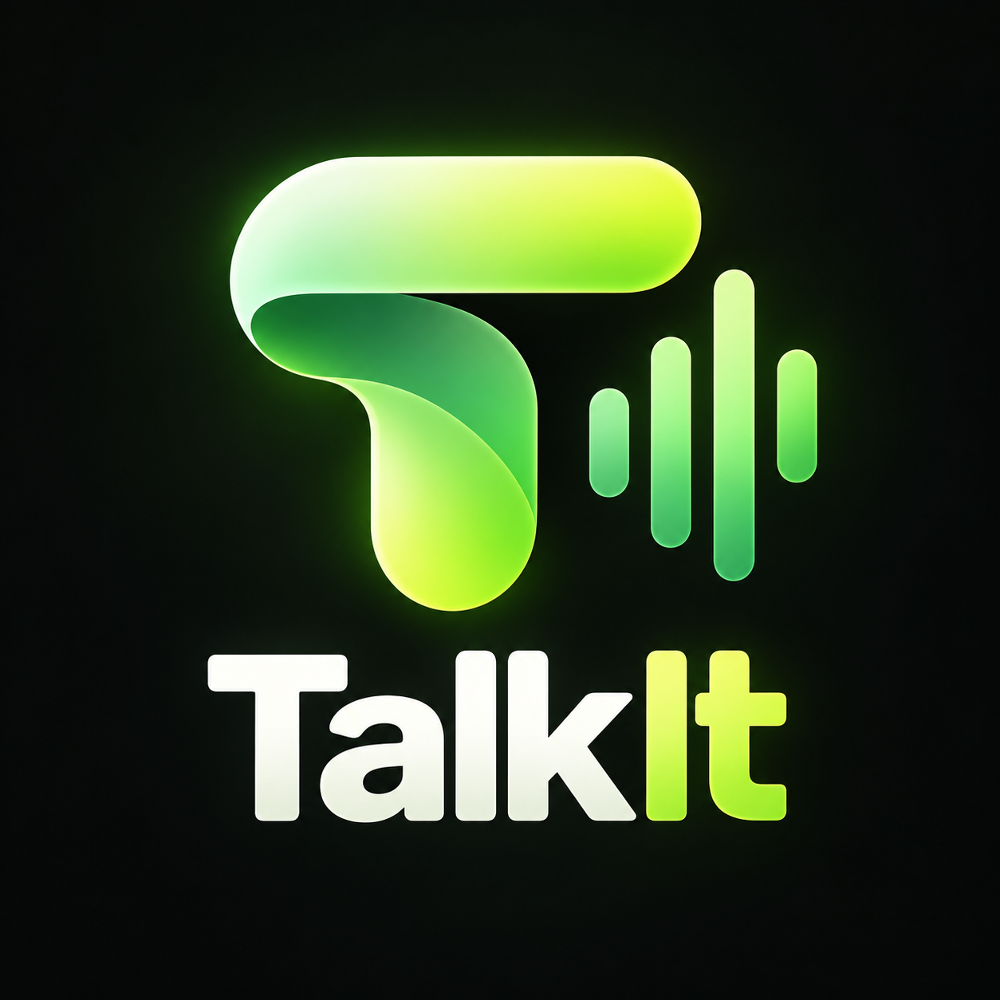
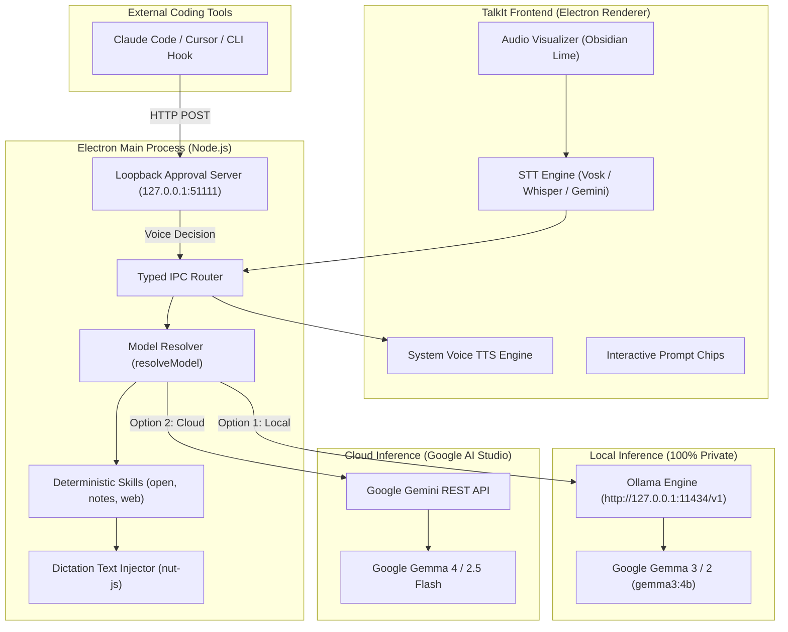
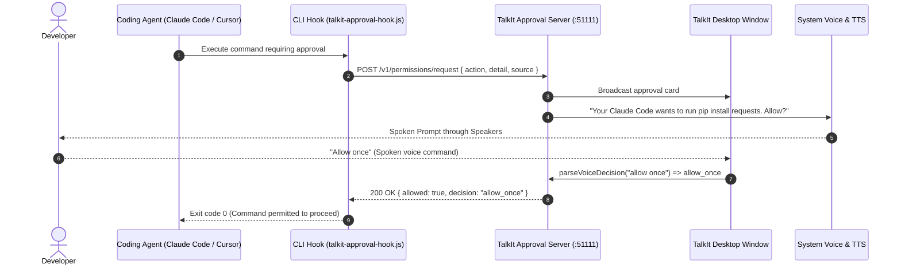

<div align="center">



# TalkIt

**A Windows-First, Gemma-Powered Voice Desktop Copilot**  
*Speak to write. Talk to act. Approve without interrupting your flow.*

[](LICENSE)
[](https://github.com/GovindUpadhyay13/TalkIt)
[](#quick-start-windows-first)
[](https://www.electronjs.org/)
[](#gemma-architecture--model-backends)
[](#testing--verification)

**Team**: Exodus &nbsp;|&nbsp; **Author**: Govind Upadhyay ([@GovindUpadhyay13](https://github.com/GovindUpadhyay13))

</div>

---

## What is TalkIt?

Software engineers spend their days bouncing between code editors, terminals, web browsers, and AI coding agents. While background AI agents (like Claude Code, Cursor, and CLI tools) are becoming faster and more autonomous, the human interaction model remains clumsy:
1. **Window switching friction**: Having to Alt-Tab away from your code just to review and click "Allow" on a terminal command.
2. **Repetitive writing strain**: Typing repetitive documentation, commit messages, and search queries by hand when speaking is 3× faster.
3. **Loss of agency**: Either blindly running unmonitored scripts with `--yes` flags or constantly getting derailed by modal confirmation popups.

**TalkIt** is an open-source, voice-driven desktop copilot purpose-built for developers on Windows 10 & 11 (with cross-platform support for macOS and Linux). Powered by **Google Gemma** (served locally through **Ollama** for 100% offline privacy, or via the **Google Gemini API** for cloud reasoning), TalkIt introduces a unified voice layer for the desktop:

- **Dictate anywhere**: Transcribe speech into any active application with automatic clipboard preservation and deduplication.
- **Control your desktop**: Launch software, take structured research notes, query live weather, and search the web using natural voice instructions.
- **Approve agent actions hands-free**: Review sensitive coding-agent operations through a local loopback approval server and approve or deny them with your voice without leaving your active window.

---

## Product Walkthrough

Here is TalkIt running live on Windows 11:

### 1. The Main Copilot Interface & Landing Surface
TalkIt floats unobtrusively on your desktop with its signature **Obsidian Lime** aesthetic, ready to capture voice commands, dictate text, or minimize into a sleek notch bar.

<p align="center">
  
</p>

### 2. Dual Google Gemma Inference Engine (Local or Cloud)
During first-time setup or at any time in Settings, you choose how Google Gemma processes your requests. Run **100% locally and offline via Ollama** (`gemma3:4b`), or connect to **Google AI Studio** to harness cloud-hosted Gemma 4 models with multimodal vision and reasoning.

<p align="center">
  
</p>

### 3. Voice Pipeline Architecture
Choose between a classic modular pipeline (local Vosk wake-word, local Whisper transcription, Gemma LLM, and high-quality system TTS) or an end-to-end realtime voice mode.

<p align="center">
  
</p>

### 4. Interactive Themes & Multiplatform Distribution
TalkIt ships with three tailored visual themes: **Obsidian Lime** (amplitude-reactive audio waveform bars), **Jarvis HUD** (cyan Stark-style holographic rings), and **Typing Cursor** (minimalist terminal caret).

<p align="center">
  
</p>

---

## Four Core Capabilities

### 1. TalkIt Write: System-Wide Wispr Flow Voice Dictation
- **Input into any active app**: Dictate naturally into VS Code, Windows Terminal, Slack, Obsidian, Chrome, or Word.
- **Voice Flow Control**: Speak freely, say `"Whisper wait"` to pause dictation and insert pending text, and say `"TalkIt continue"` to resume.
- **1-Second Smart Silence Endpointing**: Continuously tracks speech pauses and automatically completes dictation after 1 second of silence.
- **Clipboard preservation**: Uses `@nut-tree-fork/nut-js` and Electron clipboard injection. Your existing clipboard contents are preserved, transcribed text is typed in, and original clipboard contents are restored within 120ms.
- **Deduplication guard**: The dictation buffer suppresses accidental duplicate pastes and maintains a bounded history of recent dictations.
- **Global toggle**: Press <kbd>Ctrl</kbd> + <kbd>Shift</kbd> + <kbd>Space</kbd> or speak `"Hey TalkIt"` to start dictating immediately.

### 2. TalkIt Execute: Strict Execution Mode & Instant Desktop Actions
TalkIt features strict separation between voice typing and command execution:
- **Explicit Voice Mode Shift**: Normal speech stays strictly in dictation mode. Say **`"Hey TalkIt, execution mode [command]"`** (e.g. *"Hey TalkIt, execution mode open calculator"*) to switch into execution mode and trigger actions.
- **Direct Native Desktop Automation**: Built-in 50ms native executor launches system utilities instantly without cloud LLM roundtrips:
  - **Calculator**: *"open calculator"* / *"launch calc"*
  - **Notepad**: *"open notepad"* / *"launch text editor"*
  - **Browsers & Web**: *"open chrome"*, *"launch edge"*, *"open youtube.com"*, or direct web searches
  - **Terminal**: *"open terminal"* / *"launch cmd"* / *"open powershell"*
  - **Media & System**: *"open spotify"*, *"open settings"*, *"what is the time"*, *"current date"*
- **Deterministic Gemma Skills**: Complex queries leverage Google Gemma with typed, sandboxed skills:
  - **Strict URL Navigator (`openUrl`)**: Rejects dangerous schemes (`javascript:`, `file:`, `smb:`); permits only `http:`, `https:`, and `mailto:`.
  - **Local Research Notes (`notesSkill`)**: Creates, lists, and reads structured markdown notes stored locally.
  - **Live Weather Query (`weatherSkill`)**: Meteorological data via Open-Meteo with no API keys required.
  - **Web Search (`webSearchSkill`)**: Real-time web intelligence powered by Tavily.

### 3. TalkIt Approve: Hands-Free Voice Approvals for Coding Agents
**The signature workflow differentiator.** When background AI coding tools (such as Claude Code, Cursor, Copilot CLI, or terminal scripts) require permission to run bash commands or modify files:
1. The external agent invokes the included CLI hook: `node scripts/talkit-approval-hook.js`.
2. The hook dispatches a request to TalkIt's loopback HTTP server (`http://127.0.0.1:51111/v1/permissions/request`).
3. TalkIt displays the approval card in the HUD and speaks the prompt aloud:  
   *"Your Claude Code wants to run bash command: npm install express. Allow this request?"*
4. Speak your decision naturally:
   - *"Allow once"* / *"Go ahead"* &rarr; grants single-turn permission (exit code `0`).
   - *"Always allow"* &rarr; persists permission for this action type.
   - *"Deny"* / *"No"* &rarr; rejects permission (exit code `1`).
   - *"Explain that again"* &rarr; repeats details aloud without resolving.
   - *Ambiguous speech* &rarr; conservative parser rejects auto-approval; never guesses.
   - *60-second timeout* &rarr; fails closed to denial (`deny`).

### 4. TalkIt Notch HUD: Minimalist Floating Interface
TalkIt eliminates screen-covering modal clutter with a unified, discrete Top Notch bar:
- **Zero Popup Redundancy**: Dictation status, silence countdown, and execution feedback animate directly inside the persistent top Notch toggle without opening secondary overlay windows.
- **Real-Time States**: Instant visual feedback for `STANDING BY`, `TALKIT LISTENING...`, `TRANSCRIBING...`, `EXECUTING...`, and `HOLDING (WHISPER WAIT)`.
- **Global Emergency Stop**: Press <kbd>Ctrl</kbd> + <kbd>Escape</kbd> at any time to immediately kill active TTS speech and abort pending tasks.

---

## Gemma Architecture & Model Backends

TalkIt relies on Google Gemma as its reasoning core. The application implements two distinct, fully functional inference paths:



### 1. Local Inference via Ollama (100% Private & Offline)
- **Endpoint**: Connects to Ollama's local OpenAI-compatible endpoint at `http://127.0.0.1:11434/v1`.
- **Health Probing**: Real-time connection probing (`probeOllama`) verifies whether Ollama is running and whether the selected model is pulled before attempting inference.
- **Recommended Models**:
  - `gemma3:4b`: Ideal balance of speed and reasoning for modern developer laptops.
  - `gemma3:1b`: Ultra-lightweight footprint for resource-constrained systems.
  - `gemma3:12b` or `gemma2:9b`: Extended reasoning capacity for high-memory workstations.
- **Privacy & Connectivity**: Zero network requests leave your machine. Prompts, desktop notes, and file operations remain strictly on-device.

### 2. Cloud Inference via Google Gemini API
- **SDK**: Built with `@ai-sdk/google` using official Google AI Studio endpoints ([Official Docs: Gemma on Gemini API](https://ai.google.dev/gemma/docs/core/gemma_on_gemini_api)).
- **Supported Models**:
  - `gemini-2.5-flash`: Ultra-fast voice interaction, low latency tool calling (Default).
  - `gemma-4-26b-a4b-it`: Multimodal vision and step-by-step thinking reasoning.
  - `gemma-4-31b-it`: High-capacity multi-step reasoning.
  - `gemini-2.5-pro`: Deep reasoning and coding assistance.
- **Security**: The `GEMINI_API_KEY` is stored in encrypted OS storage (via DPAPI on Windows / Keychain on macOS) and never transmitted to the renderer process.

---

## Quick Start (Windows-First)

Follow these steps to run TalkIt locally from source:

### Prerequisites
- **Operating System**: Windows 10 or 11 (x64 / arm64). macOS 13+ and Ubuntu 22.04+ also supported.
- **Node.js**: `v20.x` or higher (`node -v`).
- **pnpm**: `v10.x` or higher (`npm install -g pnpm`).
- **Microphone**: Any built-in or external mic enabled in Windows Settings > Privacy & security > Microphone.

### 1. Clone & Install Dependencies
```bash
git clone https://github.com/GovindUpadhyay13/TalkIt.git
cd TalkIt
pnpm install
```

### 2. Configure Your Preferred Gemma Engine

#### Choice A: Run Locally with Ollama (Recommended for Privacy)
1. Install Ollama from [ollama.com](https://ollama.com).
2. Start the Ollama server:
   ```bash
   ollama serve
   ```
3. Pull the recommended Gemma model:
   ```bash
   ollama run gemma3:4b
   ```

#### Choice B: Run via Google Gemini API (Recommended for Cloud Speed)
1. Obtain a free API key from [Google AI Studio](https://aistudio.google.com/apikey).
2. Either create a `.env` file in the root directory:
   ```env
   GEMINI_API_KEY=AIzaSyYourGoogleApiKeyHere
   ```
   Or simply enter the key in the TalkIt Onboarding Wizard or Settings UI (<kbd>⚙️</kbd>).

### 3. Run Automated Tests
Verify that all 27 unit and integration tests pass:
```bash
pnpm test
```

### 4. Launch in Development Mode
```bash
pnpm dev
```
TalkIt will launch on your Windows desktop. You will see the signature Obsidian Lime audio orb and the status indicator **"STANDING BY..."**.

### 5. Build Production Installer
```bash
# Typecheck TypeScript codebase
pnpm typecheck

# Build packaged executable / installer (.exe for Windows)
pnpm build
pnpm dist
```
The output installer will be located in the `dist/` directory (e.g. `TalkIt-Setup.exe`).

---

## TalkIt Approve: External Coding Agent Integration

### How the Integration Works
TalkIt runs an internal HTTP server bound exclusively to `127.0.0.1:51111`. Any external script, CLI tool, or AI agent can request permission before performing a sensitive action:



### Testing the Approval Hook
You can test the approval hook right now from any terminal:

```bash
# Format: node scripts/talkit-approval-hook.js "<action>" "<details>" "<source>"
node scripts/talkit-approval-hook.js "Run Command" "npm install express" "Claude Code"
```

1. The script dispatches the request to TalkIt.
2. TalkIt presents the approval card on screen and reads the request aloud.
3. Say:
   - **"Allow once"** &rarr; Script prints `[Talkit] Decision: ALLOWED (allow_once)` and exits with **code 0**.
   - **"Deny"** &rarr; Script prints `[Talkit] Decision: DENIED (deny)` and exits with **code 1**.
   - **"Explain that again"** &rarr; TalkIt repeats the details and continues waiting.

### Supported Voice Decision Grammar
The voice decision parser (`src/main/agent/approval/voice-decision.ts`) uses strict, conservative rules:
| Spoken Phrase | Parsed Decision | Result |
| :--- | :--- | :--- |
| `"allow once"`, `"allow"`, `"approve"`, `"go ahead"`, `"yes allow"` | `allow_once` | Allowed (exit 0) |
| `"always allow"`, `"always approve"`, `"always allow this"` | `always` | Allowed (exit 0) |
| `"deny"`, `"reject"`, `"do not allow"`, `"disallow"`, `"no"` | `deny` | Denied (exit 1) |
| `"cancel"`, `"stop"`, `"abort"` | `cancel` | Denied (exit 1) |
| `"explain that again"`, `"say that again"`, `"repeat that"` | `explain` | Re-reads prompt aloud |
| *Ambiguous or unrecognized speech* | `ambiguous` | Asks user to clarify; **never auto-approves** |
| *Timeout (60s without input)* | `expired` | Defaults to **Denial** (exit 1) |

---

## Keyboard Shortcuts & Window Controls

| Action | Shortcut (Windows/Linux) | Shortcut (macOS) | Description |
| :--- | :--- | :--- | :--- |
| **Push-to-Talk** | <kbd>Ctrl</kbd> + <kbd>Shift</kbd> + <kbd>Space</kbd> | <kbd>Cmd</kbd> + <kbd>Shift</kbd> + <kbd>Space</kbd> | Instantly starts listening for a voice command or dictation. |
| **Emergency Stop** | <kbd>Ctrl</kbd> + <kbd>Escape</kbd> | <kbd>Cmd</kbd> + <kbd>Escape</kbd> | Global killswitch. Immediately aborts running tasks, TTS speech, and automation. |
| **Summon / Dismiss** | <kbd>Alt</kbd> + <kbd>Space</kbd> *(or <kbd>Ctrl</kbd>+<kbd>Alt</kbd>+<kbd>Space</kbd>)* | <kbd>Option</kbd> + <kbd>Space</kbd> | Toggles TalkIt between focused window and background. |
| **New Turn / Clear** | Click <kbd>✏️</kbd> (Top Bar) | Click <kbd>✏️</kbd> (Top Bar) | Clears current transcript and resets assistant to idle. |
| **Minimize to Notch** | Click <kbd>⤢</kbd> (Top Bar) | Click <kbd>⤢</kbd> (Top Bar) | Collapses window into a discrete top notch bar. |
| **Close Window** | Click <kbd>✕</kbd> (Top Bar) | Click <kbd>✕</kbd> (Top Bar) | Closes the TalkIt window cleanly. |

---

## Security & Safety Boundaries

TalkIt is designed to give developers convenience without compromising their machine:

1. **Process Isolation**: The user interface runs in a sandboxed Electron renderer process with `contextIsolation: true` and `nodeIntegration: false`. The renderer communicates strictly across typed IPC channels defined in `src/preload/index.ts`.
2. **Loopback Server Restriction**: The approval server binds exclusively to `127.0.0.1` and inspects `req.socket.remoteAddress`. Any incoming packet not originating from `127.0.0.1`, `::1`, or `::ffff:127.0.0.1` is immediately dropped with `403 Forbidden`.
3. **Deterministic Skills vs. Arbitrary Execution**: The LLM does not execute direct shell commands. All desktop actions are mapped to explicitly whitelisted Skill handlers with typed arguments.
4. **URL Protocol Whitelist**: The `openUrl` tool strictly enforces that URLs must match `http:`, `https:`, or `mailto:`. Non-standard, local, or executable schemes (`file:`, `javascript:`, `powershell:`, `cmd:`, `smb:`) are rejected.
5. **Fail-Closed Approvals**: If an approval prompt times out (60 seconds) or receives ambiguous speech, the server resolves to `deny` (exit code 1). It never defaults to permission granted.
6. **Credential Privacy**: API keys (`GEMINI_API_KEY`, `TAVILY_API_KEY`) are stored in local configuration files obfuscated and encrypted via OS keychain APIs where available, and are never logged or echoed to the client UI.

---

## Technical Specifications & Stack

| Layer | Technologies & Dependencies | Purpose |
| :--- | :--- | :--- |
| **Core Runtime** | Electron 42, Node.js 20+, TypeScript 5 | Cross-platform desktop application container |
| **UI Framework** | React 19, Tailwind CSS 4, Motion, Lucide Icons | Reactive interface, glassmorphic dark mode styling |
| **Build Tooling** | `electron-vite`, `vite` 7, `electron-builder` | High-speed compilation, HMR, and NSIS installer bundling |
| **AI SDK & Routing** | Vercel AI SDK (`ai`), `@ai-sdk/google`, `@ai-sdk/openai` | Unified streaming tool-calling interface |
| **Local LLM** | Ollama Engine (OpenAI-compatible local endpoint) | Local offline execution of Google Gemma models |
| **Speech-to-Text** | Vosk WASM (`vosk-browser`), Local Whisper (`@huggingface/transformers`), Gemini STT | Offline wake-word spotting and high-accuracy speech transcription |
| **Text-to-Speech** | Native System Speech Synthesis API | Zero-latency, natural voice audio feedback with pitch & rate tuning |
| **Automation** | `@nut-tree-fork/nut-js`, Electron Clipboard | Controlled keyboard input injection and clipboard preservation |
| **Testing** | Node.js native test runner (`node:test`, `tsx`) | Fast, dependency-free unit and integration test suite |

---

## Testing & Verification

TalkIt maintains a verified unit and integration test suite in the `tests/` directory:

```bash
pnpm test
```

### Verified Test Suite Output (27/27 Passing)
```text
▶ Talkit Approve — Voice Decisions & Coding Agent Server
  ▶ parseVoiceDecision
    ✔ parses explicit positive decisions
    ✔ parses explicit negative decisions
    ✔ identifies explanation requests without approving
    ✔ classifies ambiguous speech as ambiguous instead of defaulting to approval
  ✔ parseVoiceDecision
  ▶ Approval Server integration
    ✔ starts on a loopback port and provides health probe
  ✔ Approval Server integration
✔ Talkit Approve — Voice Decisions & Coding Agent Server

▶ Talkit Write — System-wide Dictation State & Deduplication
  ✔ manages dictation active and paused transitions cleanly
  ✔ handles empty and whitespace dictation gracefully without altering history
✔ Talkit Write — System-wide Dictation State & Deduplication

▶ Wispr Flow — Flow Control & Transcription Parsing
  ✔ strips leading 'Hey TalkIt' or 'TalkIt' wake words
  ✔ detects 'Whisper wait' and extracts preceding text to insert
  ✔ parses continuous transcription chunks correctly
  ✔ identifies empty and noise hallucinations as empty
  ✔ detects 'TalkIt continue' and resume commands
  ✔ detects hardcoded 'Hey TalkIt' wake command
  ✔ detects 'execution mode' and extracts task for desktop implementation
✔ Wispr Flow — Flow Control & Transcription Parsing

▶ Talkit Execute — Desktop Automation & Skills
  ✔ includes notesSkill and openSkill in BUILTIN_SKILLS
  ✔ validates openUrl to reject dangerous non-http protocols (javascript:, file:, smb:)
  ✔ notesSkill successfully creates, lists, and reads notes
  ✔ executeDirectCommand parses and matches calculator and desktop app intents
✔ Talkit Execute — Desktop Automation & Skills

▶ Google Gemma & Gemini LLM Provider
  ✔ has Google Gemini configured as the primary default provider in DEFAULT_CONFIG
  ✔ lists Google Gemini as the first provider in LLM_PROVIDERS with curated models
  ✔ getProviderMeta returns metadata for gemma
  ✔ lists gemini-gemma as second provider with Gemini API key auth and Gemma 4 models
  ✔ resolveModel throws informative error when GEMINI_API_KEY is not set
  ✔ probeOllama returns unavailable when endpoint is unreachable without hanging
  ✔ resolveModel throws informative error with setup instructions when Ollama is offline
✔ Google Gemma & Gemini LLM Provider

▶ Obsidian Lime Theme System
  ✔ has obsidian-lime as the default appearance theme in DEFAULT_CONFIG
  ✔ has TalkIt configured as the assistant name
✔ Obsidian Lime Theme System

ℹ tests 27 | suites 8 | pass 27 | fail 0 | duration_ms 2474
```

---

## Troubleshooting

- **"Ollama is not running at http://127.0.0.1:11434/v1"**:
  - Run `ollama serve` in a terminal.
  - Verify Ollama is ready by running `ollama list` or `curl http://127.0.0.1:11434/v1/models`.
- **"No Gemini API key found"**:
  - Open TalkIt Settings (<kbd>⚙️</kbd>), navigate to **Language Model**, and enter your `GEMINI_API_KEY`.
  - Alternatively, export `GEMINI_API_KEY="AIzaSy..."` before launching `pnpm dev`.
- **Microphone not detected or permission denied**:
  - On Windows 10/11: Go to **Windows Settings > Privacy & security > Microphone** and ensure "Let desktop apps access your microphone" is set to **On**.
- **Port 5173 or 51111 already in use**:
  - If a previous process is still bound, terminate it via PowerShell:
    ```powershell
    Get-Process -Id (Get-NetTCPConnection -LocalPort 5173).OwningProcess | Stop-Process -Force
    ```

---

## Roadmap

- [x] **Core Gemma Integration**: Local Ollama support + Google Gemini cloud API integration.
- [x] **TalkIt Write**: System-wide text injection with clipboard preservation and deduplication.
- [x] **TalkIt Approve**: Localhost HTTP approval server and CLI hook with conservative voice parsing.
- [x] **Obsidian Lime Theme**: Audio visualizer with amplitude-reactive vertical bars.
- [ ] **Native Windows Global Media Key Hook**: C++ low-level hook for hardware headset mute buttons.
- [ ] **Extended Agent Adapters**: Direct stdio JSON-RPC adapters for MCP (Model Context Protocol) servers.
- [ ] **Multi-turn Context Pinning**: Ability to pin active source files into Gemma's prompt memory via voice.

---

## License & Attribution

TalkIt is released under the [MIT License](LICENSE).  
Copyright &copy; 2026 **Govind Upadhyay** (Team **Exodus**).

*Built with passion for developers who want to stay in flow.*
